# BlockShips

[](https://modrinth.com/plugin/blockships) [](https://def9a2a4.github.io/discord.html)

A Minecraft plugin that lets players create rideable, physics-enabled ships. Build custom ships from blocks or spawn pre-built vessels, then sail the seas or take to the skies. All of this *without any client side mods or resource packs!*

Other plugins that work nicely with BlockShips:
- [DynLight](https://github.com/def9a2a4/DynLight) for dynamic lighting -- without this, light emitting blocks on custom ships won't work when the ship is assembled.

[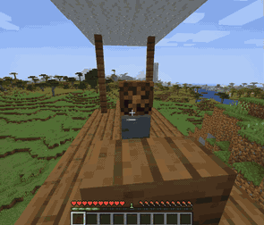](docs/assets/demo_vid.webm)


|              the prefab small spruce ship               |                 A small custom ship next to the prefab small spruce ship                 |
| :-----------------------------------------------------: | :--------------------------------------------------------------------------------------: |
| 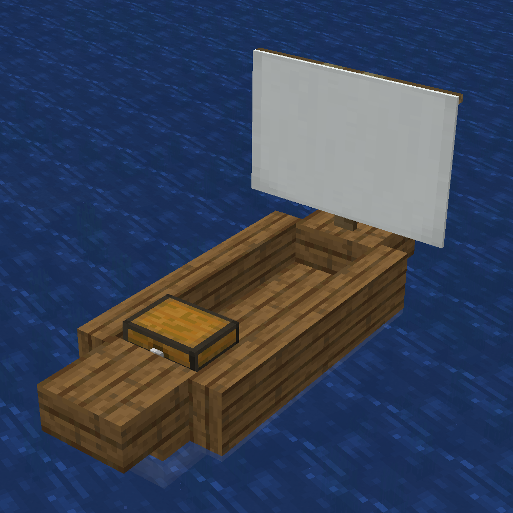 | 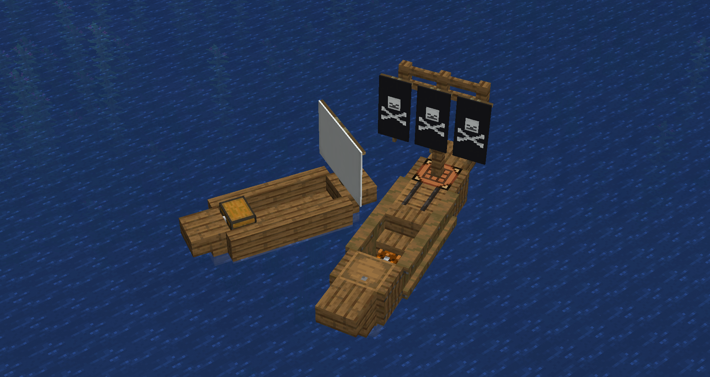 |
|                                                         |                                                                                          |

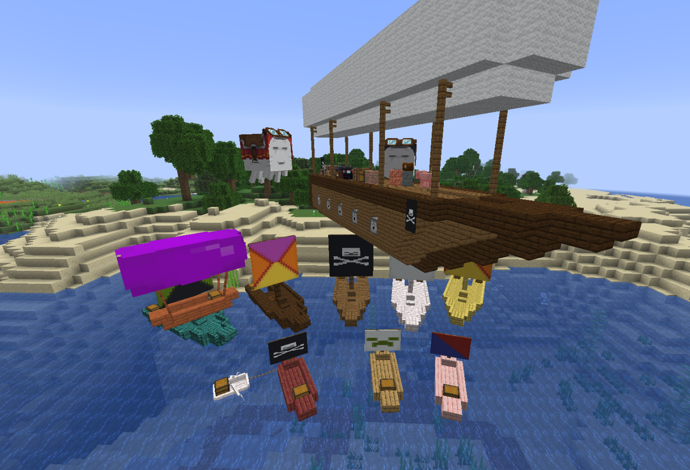


**WARNING:** THIS PROJECT IS IN ALPHA. EXPECT BUGS, MISSING FEATURES, AND BREAKING CHANGES. USE AT YOUR OWN RISK, AND BACKUP YOUR WORLD OFTEN. THE DEVELOPER IS NOT RESPONSIBLE FOR ANY DAMAGE CAUSED BY THIS PLUGIN.


# Features

Build a ship out of allowed blocks, place a Ship's wheel on it and right click, and click "assemble" in the menu. Your blocks are now a mobile ship! Depending on the density (fully configurable) of the blocks in your ship, your ship might float lower or higher in the water. Use enough "lighter than air" blocks like glowstone, and your ship will be a flying airship — or bolt on enough upward thrust and fly a heavy one. See [the flight model](docs/flight-model.md) for how lift, sail power and thrust combine.


Ships can include:

- **Functional blocks** - Crafting tables, anvils, enchanting tables work as normal. (furnaces/brewing stands don't fully yet work)
- **Storage** - Chests, barrels, dispensers, etc remain accessible
- **Seats** - bottom-half stairs become passenger seats you can sit on (wooden, copper and purpur; copper ones have to be straight). Wool carpets work too, and on Minecraft 26.3 every cushion is a seat (one behind the wheel is the driver's seat).
- **Lead points** - Anything leashed to a fence will stay tied to the ship. You can lead things to the ship while its moving. The Small Ship and Large Ship each have one lead point; the Small Airship has none.
- **Cannons** - a dispenser with a block of obsidian behind it will shoot its contents. fire all through the ship menu, or right click on the obsidian to fire.
- **Land vehicles** - hang DefCoreLib wheels on both sides of a hull and it drives on land with the same Ship's Wheel; powered wheels push it, unpowered ones roll.
- **Health & damage** - Ships have health, take damage from collisions/attacks, and regenerate over time. When they run out of health, ships will attempt to place themselves back in the world.
- **Sounds & effects** - Movement and damage come with visual effects and audio.
- **Drowned Captain** - Rare drowned mobs spawn carrying ship wheels
- **Dynamic lighting** - Light-emitting blocks (glowstone, lanterns, torches, etc.) on ships emit dynamic light when [DynLight](https://github.com/def9a2a4/DynLight) is installed (optional)

## Custom Ships

1. Build a structure from allowed blocks (see [the blocks.yml section](#blocksyml) to change the list)
  - generally, wood/metal/functional blocks are allowed, while stone/dirt/other natural blocks are not
  - light-giving blocks, like glowstone, end rods, and beacons, serve as floatation aids. enough of these, and you get an airship!
  - or skip the glowstone entirely: propellers and thrusters mounted vertically, on a floor or a ceiling, will lift a heavy hull
3. Craft a "Ship Wheel"
4. Place the wheel on your structure
5. Right-click the wheel to open its menu, and click "assemble"
6. Right-click the ship itself, or a seat, to board and steer
7. Right-click where the wheel was to open the menu again and disassemble

## Prefab Ships

Spawn ready-to-use ships, with customizable banners/colors/wood types:

- **Small Ship** - Fast, lightweight water vessel. Two seats and a double chest.
- **Large Ship** - Larger water vessel with more health. Two double chests, many seats.
- **Small Airship** - Floats in the air with vertical controls. Also two seats and a double chest.

**Command:** `/blockships give <item>` — items are `ship_wheel`, `captains_manual`, `balloon`, `smallship`, `bigship`, `smallairship`. Run `/blockships give` with no argument to print the list your server actually has.

## Physics System
- **Walk on your ships** - Players can walk around on deck while sailing/flying. this is still buggy!
- **Buoyancy** - Ships float based on block weight and density. this is buggy sometimes!
- **Propulsion** - Fans, propellers and thrusters add speed, turning or lift depending on which way they are mounted; a reaction wheel only ever turns, whichever way it sits
- **Lift** - A ship with less lift than it needs cannot climb and sinks, faster the more it is short by
- **Movement** - Acceleration, drag, and collision response
- **Collision detection** - Ships interact with terrain and entities (interacting with other ships is buggy)

## Controls

| Key    | Action                  |
| ------ | ----------------------- |
| W      | Move forward            |
| S      | Move backward / brake   |
| A      | Rotate left             |
| D      | Rotate right            |
| Space  | Ascend (flying ships)   |
| Sprint | Descend (flying ships)  |


## Crafting Recipes

| Item                                                              | Recipe                                                   |
| :---------------------------------------------------------------- | :------------------------------------------------------- |
| **Ship Wheel**                        | 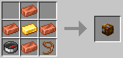       |
| **Small Ship**<br>*Wood type, banner customizable*                | 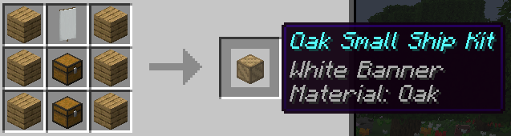       |
| **Large Ship**<br>*Wood type, banner customizable*                | 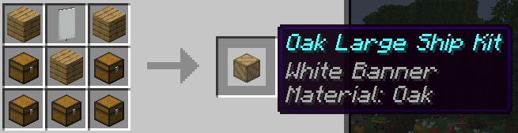       |
| **Ship Balloon**<br>*Wool color customizable*                   | 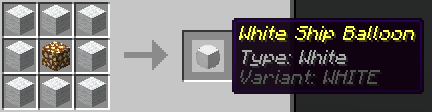   |
| **Small Airship**<br>*Wood type, balloon type customizable* | 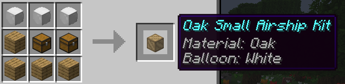 |
| **Captain's Manual**<br>*Shapeless: ship wheel + book*    | —                                                        |


## Cannons

|                  Cannons Firing                   |                                         Cannon Menu                                          |
| :-----------------------------------------------: | :------------------------------------------------------------------------------------------: |
| 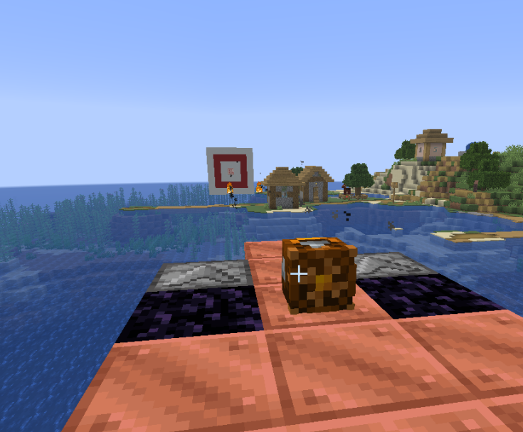 | 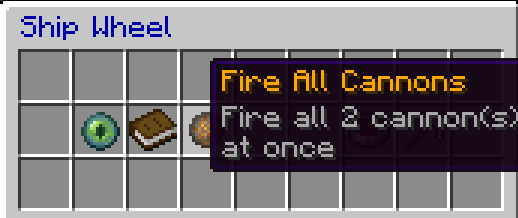 (or, right click obsidian to fire individually) |


## Commands

Commands marked † must be run by a player, not from the console.

| Command                                          | Description                                                              | Permission             |
| ------------------------------------------------- | ------------------------------------------------------------------------ | ---------------------- |
| `/blockships help`                               | Show help and list all commands                                          | -                      |
| `/blockships info`                               | Show ship and wheel statistics                                           | `blockships.info` (default: everyone) |
| `/blockships dismount` †                         | Force-dismount from a ship                                               | `blockships.dismount`  |
| `/blockships reload`                             | Reload configuration                                                     | `blockships.reload`    |
| `/blockships give <item>` †                      | Give yourself a ship wheel, kit or item                                  | `blockships.give`      |
| `/blockships spawndrowned` †                     | Spawn a wheel-carrying drowned captain                                   | `blockships.give`      |
| `/blockships recipes [player]`                   | Unlock crafting recipes                                                  | `blockships.recipes`   |
| `/blockships highlightseats` †                   | Highlight a ship's seats (debug)                                         | `blockships.highlight` |
| `/blockships highlightcolliders` †               | Highlight a ship's colliders (debug)                                     | `blockships.highlight` |
| `/blockships wheels <inspect\|list\|adopt\|purge>` | Inspect or repair ship wheel records                                     | `blockships.admin`     |
| `/blockships forceclearwheel <wheelId> <first8>` | **(DANGEROUS) Delete one wheel record** — takes the id's first 8 chars   | `blockships.admin`     |
| `/blockships forcedisassembleall confirm`        | **(DANGEROUS) Disassemble all ships**                                    | `blockships.admin`     |
| `/blockships killentities confirm`               | **(DANGEROUS) Remove ship entities in loaded chunks**                    | `blockships.admin`     |

# Installation

## Requirements

- **Paper 1.21.11 or newer**, or a Paper fork. Development and CI run on **1.21.11**, and CI also covers **26.1.2**, **26.2** and **26.3**, on both Paper and Purpur.
- **Java 21 or newer.** Note that Minecraft 26.x servers themselves require Java 25 — that is a requirement of the server jar, not of BlockShips.
- **Spigot and Folia are not supported.**

## Required

**[DefCoreLib](https://modrinth.com/plugin/defcorelib) 0.5.0 or newer.** BlockShips declares a hard dependency on it and will not load without it. DefCoreLib is also what sets the 1.21.11 floor. At startup BlockShips checks that the installed DefCoreLib is new enough, and disables itself with a message saying so if it isn't; install the DefCoreLib release published alongside this version of BlockShips.

Install only `defCoreLib-<version>.jar`. If you also drop in the `-plain` jar, Paper reports "Ambiguous plugin name" and neither loads.

## Recommended

These are DefCoreLib companion plugins. Everything they unlock already lives inside DefCoreLib — these jars switch on its **crafting recipes**. Without them the blocks still exist and still work if you already have some (from an older world, creative, or `/defcorelib give`); they just can't be crafted in survival. BlockShips logs a warning at startup naming any companion that is missing and what it costs you.

- **[Mechanism](https://modrinth.com/plugin/mechanism)** — the recipes for propellers, thrusters, fans and reaction wheels, and for the **Glue Brush** (brush + slimeball) that attaches blocks a ship couldn't otherwise carry. Jar is `Mechanism-<version>.jar`; it appears in `/plugins` as **`mech`**.
- **[BetterBanners](https://modrinth.com/plugin/betterbanners)** — large and huge banners, the two best sails (20 and 50 sail points, against 7 for a plain banner). Jar is `BetterBanners-<version>.jar`; it appears in `/plugins` as **`bbanners`**.

## Optional

- **Any protection or claim plugin** (WorldGuard, GriefPrevention, Towny, Lands, ...) — assembling a ship, placing a wheel, spawning a ship kit, firing cannons and projectiles hitting a ship all respect it: BlockShips asks the server whether you could build there, so no per-plugin support is needed.
- **[WorldGuard](https://enginehub.org/worldguard)** — additionally, disassembly inside a region you can't build in drops blocks as items instead of placing them.
- **[DynLight](https://github.com/def9a2a4/DynLight)** — light-emitting blocks on an assembled ship emit dynamic light.

## Install

1. Download `BlockShips-<version>.jar` and `defCoreLib-<version>.jar`, plus `Mechanism` and `BetterBanners` if you want them.
2. Drop them all in your server's `plugins` folder.
3. Restart the server.

No resource pack or client mod is needed.

# Configuration

## config.yml

Lives at `plugins/BlockShips/config.yml` and is read from disk normally — edit it in place. Main plugin settings including:

- Ship physics (speed, acceleration, drag)
- Buoyancy values (density, strength)
- Collision settings (mass, response)
- Cannons (cooldown, whether TNT can be fired)
- Ship damage (counted once per ship or once per block, explosion and potion handling) and health regen
- Crafting recipes

## blocks.yml

Configures which blocks can be used in custom ships:

- **Weight scale** - Affects buoyancy, and how much thrust it takes to lift the ship
- **Collider** - Custom collision shapes
- **Seat/storage** - Special block behaviors

**`blocks.yml` is read from inside the jar, not from the plugin folder.** Same for `items.yml` and the prefab ship models. That way a plugin update ships current block definitions instead of being hidden by a copy you generated two releases ago. To customize it, put your edited copy in the `config/` subfolder:

```
plugins/BlockShips/config/blocks.yml
```

A file at the plugin folder root (`plugins/BlockShips/blocks.yml`) is **not read at all**. To get a copy to edit:

```sh
unzip -o BlockShips-0.0.19.jar blocks.yml -d plugins/BlockShips/config/
```

or download [`blocks.yml`](https://raw.githubusercontent.com/def9a2a4/BlockShips/main/blockships/src/main/resources/blocks.yml) and save it to that path.

Your copy **replaces** the bundled one rather than merging with it, so start from the whole file and re-check it after each update — blocks added in later releases won't appear until you add them. The startup log tells you which copy is in force and warns when yours is missing entries the bundled default has.

To allow more blocks, add entries at the end of your copy. A key is a block name, a `"*wildcard"` or a Minecraft `"#tag"`:

```yaml
andesite:
  allowed: true
  weight: 4
  collider: true
"#stone_bricks":   # stone bricks and their mossy, cracked and chiseled variants
  allowed: true
  weight: 4
  collider: true
```

Where entries overlap, the most specific wins (a block name over a wildcard over a tag); between equally specific ones the later wins. Run `/blockships reload` to apply it; ships already assembled pick it up the next time they are docked and launched.

Note that natural blocks (stone, dirt, ores) are excluded on purpose: assembly flood-fills through connected allowed blocks, so allowing them lets a docked ship swallow the terrain it is sitting on.


# Inspiration

This plugin is inspired by mods which also implement rideable ships, as well as plugins which have attempted similar functionality. I made this plugin because I realized that with the addition of display entities, it might be possible to create a better ship plugin than previously possible, but without requiring any client-side mods. No code from any of other project has been used. In particular, this plugin was inspired by:

- [Ships](https://dev.bukkit.org/projects/ships) and [Movecraft](https://github.com/APDevTeam/Movecraft) plugins
- [Archimedes Ships mod](https://www.curseforge.com/minecraft/mc-mods/archimedes-ships)
- [Eureka Ships / Valkyrian Skies mods](https://www.valkyrienskies.org/)

Although this plugin predates them, you should also check out the extremely cool Create Aeronautics Mod, as well as the similar [SimpleShips](https://github.com/jemcdevitt/SimpleShips) plugin!


# License

You are free to use this plugin only for non-commercial projects and servers. For commercial use, please contact the author for a license. For more details, see the [`LICENSE.txt`](https://raw.githubusercontent.com/def9a2a4/BlockShips/refs/heads/main/LICENSE.txt) file.


# Developing

You will need **Java 21** and gradle installed, plus a [defCoreLib](https://github.com/def9a2a4/defCoreLib) checkout as a sibling directory — `make build` builds that first and compiles against it, and the build fails outright without it. Point elsewhere with `DEFCORELIB_DIR=` or `DEFCORELIB_JAR=` if your checkout lives somewhere else. `make build` puts the jar in `bin/`; `make test` runs the unit tests, which `build` deliberately does not.
